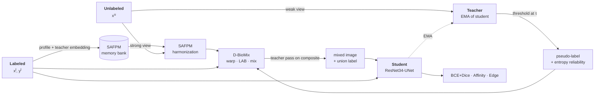

<div align="center">

# TriSynNet

**Beyond Decoupled Augmentation: Co-Designing Semantic Frequency and Deformable Mixing for Semi-Supervised Polyp Segmentation**

[](https://www.python.org/)
[](https://pytorch.org/)
[](https://lightning.ai/)
[](LICENSE)
[](#citation)

Semi-supervised polyp segmentation in which the spectral augmentation, the deformable mixing, and the consistency loss that supervises them are designed together.

</div>

---

> [!NOTE]
> This repository accompanies a manuscript under peer review. It contains the implementation of the method; quantitative tables, trained checkpoints, and the final citation entry will be added upon acceptance.

## Overview

Pixel-level annotation of colonoscopy frames is expensive, so polyp segmentation often has to learn from a small labeled set and a large unlabeled pool. TriSynNet builds on Mean Teacher consistency training with three components; each augmentation is paired with the loss term designed for the perturbation it introduces.

| Component | Module | Mechanism | Paired loss term |
| :-- | :-- | :-- | :-- |
| **SAFPM**<br/>Semantic-Aware Frequency Profile Matching | `models/safpm.py` | A memory bank of *directional* frequency profiles (Laplacian high-frequency band → FFT → $K$ angular sectors), each keyed by an encoder feature embedding. Softmax attention over the embeddings retrieves a prior for each unlabeled image, which is blended into the amplitude spectrum of its high-frequency band with strength $\gamma_c = 0.05 + 0.15\tanh(d_c)$; the phase is kept. | `LocalAffinityLoss` |
| **D-BioMix**<br/>Deformable Bio-Harmonized Mixing | `models/d_biomix.py` | Pastes a labeled source lesion into an unlabeled target after LAB luminance matching and a sparse $G \times G$ control-point warp (bicubic upsampling), then applies SAFPM harmonization to the composite. The pasted region follows the warped lesion mask rather than a rectangle. | `EdgeAlignmentLoss` |
| **TriSynergy Loss** | `losses.py` | Curriculum-weighted sum of BCE+Dice, a Local Affinity term designed for spectral perturbation, and an Edge Alignment term on 3×3 Sobel gradients, weighted by an entropy-based reliability mask. | — |

### Pipeline



Per iteration (`PolypSSLSystem.training_step`):

1. The teacher predicts the weak view of the unlabeled batch; thresholding at τ gives the pseudo-label, and the binary entropy of the prediction gives the reliability mask $\mathcal{M} = 1 - \mathrm{clamp}(H/\log 2, 0, 1)$.
2. Teacher features of the labeled batch update the SAFPM memory bank (direct filling, then EMA refinement of the nearest slot).
3. SAFPM harmonizes the strong view of the unlabeled batch, using the student embedding of that view as the retrieval query.
4. D-BioMix mixes the labeled strong view into the harmonized unlabeled view. The mixed label is the union of the target pseudo-label, the warped source mask, and a teacher prediction on the composite; the reliability mask is set to 1 inside the pasted region.
5. The student is optimized on the labeled view (supervised BCE+Dice) and on the mixed sample (TriSynergy), with the consistency weight λ(t) ramping linearly from 0 to 1 over the first 20 epochs.

No gradient flows through the bank, the retrieval, D-BioMix, or the teacher. Neither SAFPM nor D-BioMix is used at inference, so inference cost equals that of the backbone.

## Repository layout

```
trisynnet/
├── models/
│   ├── backbone.py     # ResNet34UNet, ResNet34UNet_SSL (+ extract_features)
│   ├── safpm.py        # frequency-profile bank + adaptive harmonization
│   └── d_biomix.py     # LAB matching, control-point warp, mixing
├── data/dataset.py     # SemiSupervisedPolypDS, build_semisup_loaders
├── losses.py           # LocalAffinity, EdgeAlignment, TriSynergy, BceDice
├── metrics.py          # Dice/IoU/Pre/Rec + HD95/ASSD/Boundary IoU/Boundary F1
├── config.py           # TrainingConfig
└── system.py           # PolypSSLSystem, PolypDataModule
train.py                # CLI: new / resume / test
```

## Installation

```bash
git clone https://github.com/Ngoc-LM/SSL4PolypSeg.git && cd SSL4PolypSeg
python -m venv .venv && source .venv/bin/activate
pip install -r requirements.txt
```

The experiments in the manuscript used PyTorch 2.10.0, PyTorch Lightning 2.6.5 and CUDA 12.8 on a single NVIDIA Tesla T4 (16 GB), in full FP32 precision. The ResNet-34 encoder is initialized with ImageNet weights from `torchvision`, which are downloaded on first use.

> [!NOTE]
> In `albumentations` ≥ 2.0, the `var_limit` argument of `GaussNoise` (used in the strong augmentation) is not recognized and the transform falls back to its default noise level. Use the `albumentations` version of your environment consistently when comparing runs.

## Data

The five datasets are stored as arrays of a single archive, available at <https://www.kaggle.com/datasets/anduri/five-polypdataset> (`polypData.npz`, SHA-256 `c993aca56e8caf4e1b433ddd235608a0dba65a4929d0bffd9a15cc83a356d025`). Each split is stored under `{split}_img` / `{split}_msk`:

| Key prefix | Images | Role |
| :-- | --: | :-- |
| `train` | 1,290 | Training pool (Kvasir-SEG + CVC-ClinicDB), split into labeled and unlabeled subsets by `labeled_ratio` and `seed`. |
| `val` | 160 | Held-in validation set (100 Kvasir-SEG + 60 CVC-ClinicDB); the only split used for checkpoint selection, early stopping, and learning-rate scheduling. |
| `test_kvasir`, `test_clinic` | 100, 62 | Held-in test sets. |
| `test_etis`, `test_colon`, `test_cvc300` | 196, 380, 60 | Held-out test sets (ETIS, CVC-ColonDB, CVC-300), not used for training, model selection, or tuning. |

**Format.** Images are BGR `uint8` (OpenCV convention); masks may be `{0,1}` or `{0,255}` and are normalized on load. Each training sample yields a weak geometric view for the teacher (flips, rot90, affine) and a strong photometric view for the student (RGB shift, brightness–contrast, HSV jitter, Gaussian noise, Gaussian blur).

**Labeled/unlabeled split.** `build_semisup_loaders` shuffles the 1,290 training indices with `numpy.random.default_rng(seed)` and takes the first `int(1290 × labeled_ratio)` as labeled: with `seed=42`, 64 labeled / 1,226 unlabeled at 5% and 129 / 1,161 at 10%.

`guard_val_dataset()` raises an error if `config.val_dataset` is anything other than `"val"`, so the test splits cannot be used for model selection; they are read only by the test step.

## Usage

```bash
# Train from scratch (10% labeled, seed 42)
python train.py --mode new --data_path data/polypData.npz --labeled_ratio 0.1 --seed 42

# Resume an interrupted run (restores weights, teacher, SAFPM bank, optimizer and scheduler)
python train.py --mode resume --data_path data/polypData.npz --resume_ckpt checkpoints/last.ckpt

# Evaluate a checkpoint on every test split in the archive
python train.py --mode test --data_path data/polypData.npz --resume_ckpt checkpoints/<best>.ckpt
```

The test step prints, per test set, Dice, IoU, Precision and Recall (%), HD95 and ASSD (pixels), and Boundary IoU and Boundary F1, together with the number of images for which HD95/ASSD are undefined.

### Ablations

| Configuration | Flags |
| :-- | :-- |
| Full TriSynNet | *(defaults)* |
| w/o SAFPM (D-BioMix without spectral harmonization) | `--no_safpm` |
| w/o D-BioMix | `--no_d_biomix` |
| w/o TriSynergy loss (BCE+Dice consistency only) | `--loss_type bce_dice` |
| Mean Teacher baseline | `--no_safpm --no_d_biomix --loss_type bce_dice` |

### Configuration

Defaults in `trisynnet/config.py` follow Section 4.2 and the equations of Section 3 of the manuscript.

| Group | Parameters | Values |
| :-- | :-- | :-- |
| **Data** | `img_size` / `val_size` · `labeled_ratio` | 256 / 256 · 0.1 |
| | `batch_train` (32 labeled + 32 unlabeled) / `batch_val` | 64 / 8 |
| **SAFPM** | `bank_size` · `feature_dim` · `num_sectors` · `pyramid_levels` | 50 · 512 · 8 · 3 |
| | `safpm_base_gamma` → `safpm_max_gamma` · `gamma_scale` · `safpm_temperature` · `bank_ema_alpha` | 0.05 → 0.20 · 1.0 · 0.07 · 0.99 |
| **D-BioMix** | `grid_size` · `deform_magnitude` · `mix_prob` | 6 · 0.15 · 0.5 |
| **TriSynergy** | `edge_gradient` · curriculum $w_{corr} = 1 - 0.5\rho$, $w_{edge} = 0.1 + 0.9\rho$ | `sobel` |
| **Mean Teacher** | `ema_alpha` · `rampup_epochs` (linear) · `tau` | 0.99 · 20 · 0.85 |
| **Optimization** | AdamW (`adamw_eps` 1e-10) + `ReduceLROnPlateau` on validation Dice | factor 0.5, patience 7 |
| | `lr` → `min_lr` · `weight_decay` · `max_epochs` · `early_stop_patience` | 1e-4 → 1e-7 · 1e-4 · 100 · 20 |
| | `precision` · `grad_clip_norm` · `seed` | `32` · 1.0 · 42 |

> [!NOTE]
> **Implementation options.** `--edge_gradient forward_diff` replaces the 3×3 Sobel operator of the Edge Alignment term with forward finite differences, and `--gamma_scale` sets the factor inside $\tanh(\cdot)$ of the adaptive blending strength. The checkpoints behind the results reported in the manuscript were trained with `--edge_gradient forward_diff --gamma_scale 5`; use these flags to reproduce that configuration.

## Evaluation protocol

`trisynnet/metrics.py` reports region-overlap and boundary-specific metrics on binarized predictions (threshold 0.5), at 256×256.

| Metric | Definition |
| :-- | :-- |
| **Dice**, **IoU**, **Precision**, **Recall** | Per-image region overlap, averaged over images. A small constant (1e-8) is added to numerator and denominator, so an empty prediction gives Precision = 1. |
| **HD95**, **ASSD** | 95th-percentile Hausdorff distance and average symmetric surface distance between mask boundaries, in pixels. |
| **Boundary IoU** | Cheng *et al.*, CVPR 2021, with the band width set to 2% of the image diagonal. |
| **Boundary F1** | Boundary precision/recall at a 2-pixel tolerance. |

When exactly one of prediction and ground truth is empty, HD95 and ASSD are undefined (`nan`) and excluded from the mean; `aggregate_boundary_metrics` returns `n_total` and `n_excluded_nan` with each mean.

## Results

Quantitative results on Kvasir-SEG, CVC-ClinicDB, ETIS, CVC-ColonDB, and CVC-300, and trained checkpoints, will be added upon acceptance.

## Citation

The final entry will be added once the manuscript is accepted; until then, please cite the repository:

```bibtex
@misc{trisynnet2026,
  title        = {Beyond Decoupled Augmentation: Co-Designing Semantic Frequency and Deformable Mixing for Semi-Supervised Polyp Segmentation},
  author       = {{TriSynNet Authors}},
  year         = {2026},
  howpublished = {\url{https://github.com/Ngoc-LM/SSL4PolypSeg}},
  note         = {Manuscript under review}
}
```

## License

Released under the MIT License — see [LICENSE](LICENSE).
